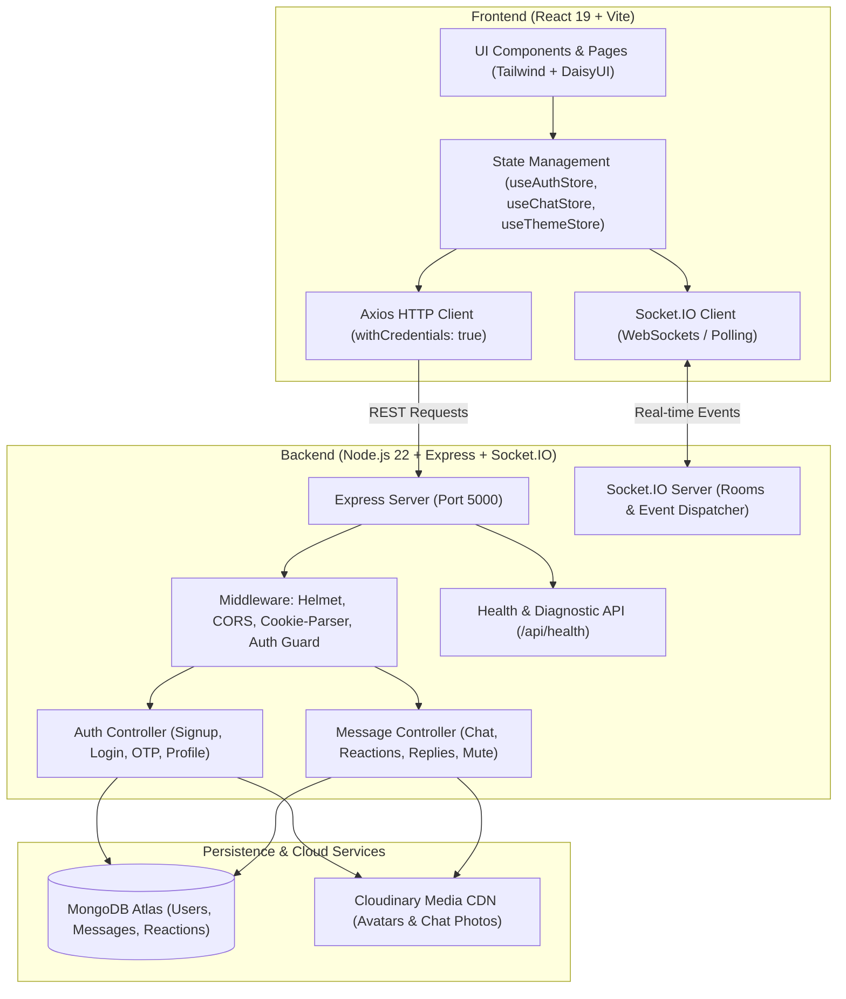

# Saṃlāpa — Real-Time Chat Application

<div align="center">

> **Saṃlāpa** (संलाप / સંલાપ) — *A Sanskrit and Indic term meaning meaningful conversation, dialogue, or intimate discourse.*

A full-stack, real-time messaging application engineered with the MERN stack, WebSockets via Socket.IO, and Cloudinary media processing. Designed for instantaneous communication with presence tracking, unread counters, message reactions, threaded replies, and customizable theme palettes.

[](https://samlapa-x7hq.onrender.com)
[](https://github.com/vagelavibhu2007/Real-Time-Chat-Application)

<br/>

[](https://react.dev/)
[](https://vitejs.dev/)
[](https://nodejs.org/)
[](https://expressjs.com/)
[](https://www.mongodb.com/atlas)
[](https://socket.io/)
[](https://tailwindcss.com/)
[](https://daisyui.com/)
[](https://cloudinary.com/)
[](https://www.docker.com/)
[](https://opensource.org/licenses/ISC)

</div>

---

## 🚀 Live Demo

Experience the live application deployed on Render:

🔗 **[https://samlapa-x7hq.onrender.com](https://samlapa-x7hq.onrender.com)**

> [!NOTE]
> Render's free-tier instances may enter a sleep state after periods of inactivity. If accessing the site for the first time in a while, please allow 30–50 seconds for the container service to spin up.

---

## 📖 Table of Contents

- [Project Overview](#-project-overview)
- [Features](#-features)
- [Tech Stack](#-tech-stack)
- [Project Architecture](#-project-architecture)
- [Installation and Setup](#-installation-and-setup)
- [Environment Variables](#-environment-variables)
- [Running Locally](#-running-locally)
- [Deployment on Render](#-deployment-on-render)
- [Folder Structure](#-folder-structure)
- [Future Enhancements](#-future-enhancements)
- [Author](#-author)

---

## 🌟 Project Overview

**Saṃlāpa** is a real-time chat web platform built to provide a modern, responsive, and distraction-free messaging experience. Unlike traditional polling-based chat systems, Saṃlāpa uses persistent bidirectional WebSocket connections powered by **Socket.IO** to deliver messages and status changes with sub-second latency.

The platform provides a complete end-to-end communication lifecycle:
1. **Secure Onboarding**: Users sign up or log in with hashed credentials and secure HTTP-only cookie-based JWT sessions.
2. **Instant Contact Discovery**: Browse registered contacts, view live online/offline presence indicators, and observe real-time typing indicators.
3. **Rich Conversations**: Exchange formatted text and high-resolution images hosted on Cloudinary, react to messages with emoji expressions, reply inline to specific context bubbles, and delete personal messages.
4. **Activity Management**: Conversations dynamically sort by the most recent message activity (WhatsApp style), with real-time unread badges and flexible conversation muting controls.
5. **Personalized Look and Feel**: Choose across 32 themes provided by DaisyUI, preserved seamlessly in browser storage.

---

## ✨ Features

### ⚡ Real-Time Chat & Messaging
- **Instant Bidirectional Messaging**: Messages are saved to MongoDB and broadcast across Socket.IO rooms without page refreshes.
- **Image Attachments**: Send photos with automatic upload and compression via Cloudinary CDN integration.
- **Threaded Inline Replies**: Context-aware replies that link directly to an original message with a preview banner.
- **Emoji Reactions**: Interactive reaction picker (`👍`, `❤️`, `😂`, `😮`, `😢`, `🔥`) supporting addition, toggling, and removal with instant socket synchronization.
- **Message Deletion**: Users can delete their sent messages, automatically scrubbing them from both active participant screens.
- **Read Receipts & Timestamps**: Visual delivery status with double checkmarks and precise message delivery times.

### 👥 Presence & User Experience
- **Live Online/Offline Status**: Real-time broadcast of online peers using server-side socket mapping with multi-tab connection handling.
- **Real-Time Typing Indicators**: Instant feedback when a contact is actively composing a message in chat.
- **WhatsApp-Style Activity Sorting**: Sidebar contact lists auto-sort in descending order based on the latest interaction timestamp.
- **Unread Message Badges**: Dedicated numeric badges per contact and global notification badges for unread incoming messages.
- **Conversation Muting**: Mute notifications per chat for customizable intervals (`1 Hour`, `8 Hours`, `24 Hours`, `Indefinite`, or `Unmute`).
- **Dual Notification System**: Custom in-app animated notification banners combined with browser Web Notification API integration.

### 🔒 Authentication & Account Management
- **JSON Web Token (JWT) Security**: Session tokens are signed server-side and stored inside secure, HTTP-only, SameSite cookies to protect against XSS and token interception.
- **Bcrypt Password Hashing**: Passwords undergo salted hashing (`bcryptjs`) before persistence.
- **Password Reset with OTP**: Built-in 6-digit OTP verification flow with 10-minute expiry for password recovery.
- **Profile Customization**: Users can upload and update their personal avatar with automatic Cloudinary storage.
- **Protected Client & Server Routes**: Navigation guards prevent unauthorized access, automatically redirecting between auth and application views.

### 🎨 Customization & System Health
- **32 DaisyUI Themes**: A built-in theme picker with real-time live preview and persistent client-side `localStorage` caching.
- **Dedicated Health Endpoint**: A public `/api/health` diagnostic endpoint providing sanitized status for MongoDB connectivity, JWT environment readiness, and system uptime.

---

## 🛠️ Tech Stack

### Frontend
| Technology | Version | Purpose |
| :--- | :--- | :--- |
| **React** | `v19.2.4` | Modern UI library with concurrent rendering and hooks |
| **Vite** | `v8.0.1` | Next-generation frontend build tool and dev server |
| **Tailwind CSS** | `v4.2.2` | Utility-first CSS styling framework |
| **DaisyUI** | `v5.5.19` | Semantic Tailwind component classes and theme system |
| **Zustand** | `v5.0.12` | Lightweight, scalable state management |
| **Socket.IO Client** | `v4.8.3` | Real-time WebSocket connection to backend |
| **Axios** | `v1.14.0` | Promise-based HTTP client with credential support |
| **React Router** | `v7.14.0` | Declarative client-side routing and protected routes |
| **Lucide React** | `v1.7.0` | Clean and consistent SVG icons |
| **React Hot Toast** | `v2.6.0` | Interactive notifications and alert toasts |

### Backend
| Technology | Version | Purpose |
| :--- | :--- | :--- |
| **Node.js** | `v22+ LTS` | Server-side JavaScript runtime with ES modules |
| **Express.js** | `v4.19.2` | RESTful API routing and web application framework |
| **Socket.IO** | `v4.8.3` | Real-time WebSocket server and room management |
| **Mongoose** | `v9.4.1` | Object Data Modeling (ODM) library for MongoDB |
| **jsonwebtoken** | `v9.0.3` | Stateless authentication tokens in HTTP-only cookies |
| **bcryptjs** | `v3.0.3` | Cryptographic password hashing |
| **Cloudinary SDK** | `v2.9.0` | Cloud media upload, transformation, and storage |
| **Helmet** | `v8.1.0` | Security headers and Content Security Policy (CSP) |
| **CORS** | `v2.8.6` | Cross-Origin Resource Sharing handling for dev mode |
| **Validator** | `v13.15.35` | Server-side email and payload validation |

### Database & Cloud Services
- **Database**: MongoDB (Atlas Cloud Cluster or local MongoDB instance)
- **Media CDN**: Cloudinary Media Management
- **Containerization**: Docker (Multi-stage Node.js 22 Debian Slim image)
- **Deployment**: Render Cloud Platform (Web Service with Docker runtime)

---

## 📐 Project Architecture



### Runtime Data Flow
1. **Authentication Flow**: Credentials sent over HTTPS &rarr; validated via `validator` and `bcryptjs` &rarr; JWT issued in an `httpOnly`, `sameSite`, secure cookie &rarr; client automatically connects to the Socket.IO server using authenticated user identity.
2. **Messaging Flow**: Message payload (`text`, `image`, `replyTo`) sent via Axios &rarr; uploaded to Cloudinary (if image attached) &rarr; persisted in MongoDB &rarr; emitted via `io.to(receiverId).emit('newMessage', message)` &rarr; receiver's store updates instantly with unread counter increment and audio/visual notification.
3. **Production Static Serving**: In production mode (`NODE_ENV=production`), Express statically serves the compiled Vite client from `frontend/dist` and handles single-page app route fallback to `index.html`.

---

## 💻 Installation and Setup

### Prerequisites
Before starting, ensure you have the following installed:
- **Node.js** (`v20.x` or `v22.x LTS` recommended)
- **npm** (`v10.x` or higher)
- **Git**
- A free **[MongoDB Atlas](https://www.mongodb.com/atlas)** account (or local MongoDB)
- A free **[Cloudinary](https://cloudinary.com/)** account

### 1. Clone the Repository
```bash
git clone https://github.com/vagelavibhu2007/Real-Time-Chat-Application.git
cd Real-Time-Chat-Application
```

### 2. Install Dependencies
You can install dependencies for all workspaces at once using the root build command:
```bash
npm run build
```
Or install dependencies separately for backend and frontend:
```bash
npm install --prefix backend
npm install --prefix frontend --include=dev
```

---

## 🔑 Environment Variables

Create a `.env` file in the **root directory** (and optionally inside `backend/.env` for isolated backend runs). You can copy from `.env.example`:

```bash
cp .env.example .env
```

Populate the `.env` file with your configuration:

```env
# Server Configuration
PORT=5000
NODE_ENV=development

# MongoDB Connection String (MongoDB Atlas or Local MongoDB)
MONGO_URL=mongodb+srv://<username>:<password>@<cluster-address>.mongodb.net/samlapa?retryWrites=true&w=majority

# JWT Authentication Secret (Generate a strong random string)
JWT_SECRET=your_jwt_secret_key_minimum_32_characters

# Cloudinary Credentials (Found in Cloudinary Dashboard)
CLOUDINARY_CLOUD_NAME=your_cloudinary_cloud_name
CLOUDINARY_API_KEY=your_cloudinary_api_key
CLOUDINARY_API_SECRET=your_cloudinary_api_secret
```

### Variable Details
| Variable | Description | Example / Source |
| :--- | :--- | :--- |
| `PORT` | Local server port (Default: `5000`). Automatically assigned on Render. | `5000` |
| `NODE_ENV` | Environment mode (`development` or `production`). | `development` |
| `MONGO_URL` | MongoDB connection URI with read/write database permissions. | MongoDB Atlas &rarr; Connect &rarr; Drivers |
| `JWT_SECRET` | Secret key used to sign and verify JSON Web Tokens. | Random 64-char hex string |
| `CLOUDINARY_CLOUD_NAME` | Cloudinary account identifier for media storage. | Cloudinary Dashboard |
| `CLOUDINARY_API_KEY` | Public API key for Cloudinary integration. | Cloudinary Dashboard |
| `CLOUDINARY_API_SECRET` | Private API secret for Cloudinary integration. | Cloudinary Dashboard |

> [!WARNING]
> Never commit your `.env` file or sensitive credentials to GitHub. Ensure `.env` is listed inside `.gitignore`.

---

## 🏃 Running Locally

### Option A: Concurrent Development Mode (Recommended)
Run the backend and frontend in separate terminals for hot-reloading:

**Terminal 1 — Backend (API & Socket Server):**
```bash
npm run dev --prefix backend
```
*Backend runs on `http://localhost:5000` with Nodemon reload.*

**Terminal 2 — Frontend (Vite Client):**
```bash
npm run dev --prefix frontend
```
*Frontend runs on `http://localhost:5173` with instant Vite HMR.*

Open **`http://localhost:5173`** in your browser.

---

### Option B: Production Build Simulation
To test the production build locally exactly as Render runs it:

```bash
# 1. Build frontend and install dependencies
npm run build

# 2. Start the unified production server
npm start
```
Open **`http://localhost:5000`** in your browser. Express serves both the backend API and the static frontend build.

---

### (Optional) Seed Sample Users
The repository includes a database seed script to populate test user contacts:

```bash
node backend/src/seeds/user.seed.js
```

---

## ☁️ Deployment on Render

This project is preconfigured for deployment on **Render** using Docker.

### How the Docker Deployment Works
The root [`Dockerfile`](Dockerfile) uses `node:22-bookworm-slim` to perform a unified build:
1. Copies `package*.json` manifests from the root, backend, and frontend.
2. Installs production and build dependencies (`npm install --prefix backend && npm install --prefix frontend --include=dev`).
3. Compiles the React client using Vite (`npm run build --prefix frontend`).
4. Starts the Node.js Express server (`CMD ["npm", "start"]`), which serves the API, Socket.IO, and static assets from `frontend/dist`.

### Deployment Steps on Render
1. Log in to [Render](https://render.com/) and click **New +** &rarr; **Web Service**.
2. Connect your GitHub repository: `https://github.com/vagelavibhu2007/Real-Time-Chat-Application`.
3. Configure the service settings:
   - **Name**: `samlapa` (or preferred name)
   - **Language**: `Docker`
   - **Branch**: `main`
   - **Region**: Closest to your users (e.g., Frankfurt, Singapore, Oregon)
   - **Instance Type**: `Free`
4. Add the **Environment Variables** in the Render Dashboard:
   - `MONGO_URL` = `<Your MongoDB Atlas Connection String>`
   - `JWT_SECRET` = `<Your Cryptographically Secure Secret>`
   - `NODE_ENV` = `production`
   - `CLOUDINARY_CLOUD_NAME` = `<Your Cloudinary Cloud Name>`
   - `CLOUDINARY_API_KEY` = `<Your Cloudinary API Key>`
   - `CLOUDINARY_API_SECRET` = `<Your Cloudinary API Secret>`
   *(Note: `PORT` is automatically injected by Render; do not hardcode it).*
5. Set Health Check Path:
   - **Health Check Path**: `/api/health`
6. Click **Create Web Service**. Render will automatically build the Docker container and roll out your deployment.

---

## 📁 Folder Structure

```text
samlapa/
├── Dockerfile                      # Production Docker container build file
├── package.json                    # Root scripts for building and running
├── package-lock.json               # Lockfile for root workspace
├── .env.example                    # Template for environment variables
├── .dockerignore                   # Docker build exclusions
├── .gitignore                      # Git tracking exclusions
├── README.md                       # Project documentation
│
├── backend/                        # Express.js & Socket.IO server
│   ├── package.json                # Backend dependencies and scripts
│   └── src/
│       ├── index.js                # Server entry point & static file handler
│       ├── controllers/
│       │   ├── auth.controller.js  # Signup, login, logout, OTP reset, profile
│       │   └── message.controller.js # Messaging, reactions, replies, mute
│       ├── lib/
│       │   ├── cloudinary.js       # Cloudinary SDK configuration
│       │   ├── db.js               # MongoDB connection & health check helpers
│       │   ├── socket.js           # Socket.IO instance & connection maps
│       │   └── utils.js            # JWT cookie generator & token helpers
│       ├── middleware/
│       │   └── auth.middleware.js  # Protected route JWT authorization guard
│       ├── models/
│       │   ├── messages.model.js   # Message schema with reactions & replyTo
│       │   └── users.model.js      # User schema with mutedConversations
│       ├── routes/
│       │   ├── auth.routes.js      # /api/auth authentication endpoints
│       │   └── message.routes.js   # /api/messages chat endpoints
│       └── seeds/
│           └── user.seed.js        # Test data population script
│
└── frontend/                       # React 19 + Vite client application
    ├── index.html                  # HTML template entry point
    ├── package.json                # Frontend dependencies and Vite scripts
    ├── vite.config.js              # Vite build configuration with React plugin
    ├── public/                     # Static assets (favicons, sounds, avatars)
    └── src/
        ├── main.jsx                # React root mount entry point
        ├── App.jsx                 # Application routes and navigation guards
        ├── App.css                 # Component styling rules
        ├── index.css               # Global Tailwind CSS and theme imports
        ├── assets/                 # SVGs and UI graphics
        ├── components/
        │   ├── Navbar.jsx          # Top navigation bar with theme & profile
        │   ├── Sidebar.jsx         # User contacts list with activity sorting
        │   ├── ChatContainer.jsx   # Message bubbles, reactions & replies
        │   ├── ChatHeader.jsx      # Chat partner info, typing status & mute
        │   ├── MessageInput.jsx    # Text input, image attachment & reply bar
        │   ├── NoChatSelected.jsx  # Empty placeholder state for chat
        │   ├── AuthImagePattern.jsx# Split-screen decorative graphic for auth
        │   ├── InAppNotification.jsx# Animated in-app notification component
        │   └── skeletons/          # Shimmer loading states
        │       ├── MessageSkeleton.jsx
        │       └── SidebarSkeleton.jsx
        ├── constants/
        │   └── index.js            # 32 DaisyUI theme definitions
        ├── lib/
        │   ├── axios.js            # Configured Axios instance with base URL
        │   └── utils.js            # Timestamp formatting utilities
        ├── pages/
        │   ├── HomePage.jsx        # Split-pane primary chat screen
        │   ├── SignUpPage.jsx      # New account registration view
        │   ├── LoginPage.jsx       # User login view
        │   ├── ForgotPasswordPage.jsx # 6-digit OTP password reset view
        │   ├── ProfilePage.jsx     # User avatar upload & profile details
        │   └── SettingsPage.jsx    # Theme selector with interactive previews
        └── store/
            ├── useAuthStore.js     # Zustand store for auth & socket lifecycle
            ├── useChatStore.js     # Zustand store for messages, replies & mute
            └── useThemeStore.js    # Zustand store for persistent themes
```

---

## 🔮 Future Enhancements

- [ ] **Group Chats & Channels**: Create multi-user channels with role-based permissions (admin/member).
- [ ] **End-to-End Encryption (E2EE)**: Implement client-side cryptographic key exchange for private 1-on-1 chats.
- [ ] **Voice & Video Calling**: WebRTC-powered audio and video calls directly within the chat workspace.
- [ ] **Message Search & Filtering**: Full-text search across conversations with date-range filters.
- [ ] **File & Document Sharing**: Expand Cloudinary and grid storage support to PDFs, documents, and voice notes.
- [ ] **Push Notifications**: Web Push API and Service Workers for background notifications when tabs are closed.

---

## 👤 Author

**Vagela Vibhu**

- **GitHub**: [@vagelavibhu2007](https://github.com/vagelavibhu2007)
- **Email**: [vagelavibhu2007@gmail.com](mailto:vagelavibhu2007@gmail.com)
- **Repository**: [Real-Time-Chat-Application](https://github.com/vagelavibhu2007/Real-Time-Chat-Application)
- **Live Demo**: [https://samlapa-x7hq.onrender.com](https://samlapa-x7hq.onrender.com)

---

<div align="center">

Made with ❤️ for seamless, real-time communication.

*If you found this project helpful or inspiring, feel free to give it a ⭐️ on GitHub!*

</div>
